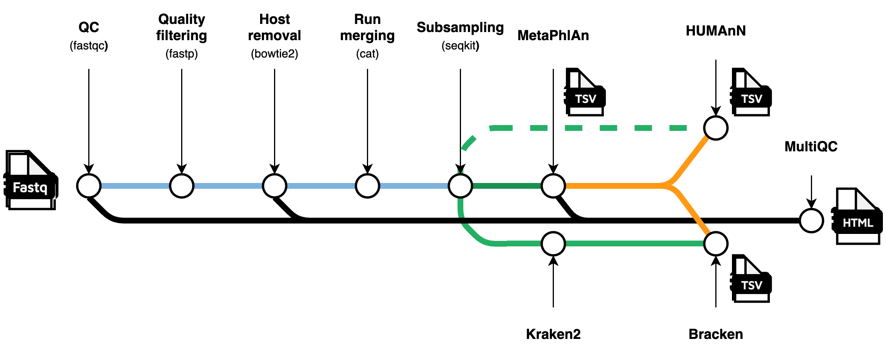

# Metagenomics pipeline to get taxonomy and pathways

[](https://www.nextflow.io/)
[](https://docs.conda.io/en/latest/)
[](https://www.docker.com/)
[](https://sylabs.io/docs/)
[](https://doi.org/10.5281/zenodo.10663325)

## Introduction

**metagenomicspipeline** is a bioinformatics pipeline that processes shotgun metagenomics reads to obtain taxonomic profiles and pathway abundances, using bioBakery software (MetaPhlAn, HUMAnN) and optionally Kraken2/Bracken. The databases are downloaded as part of the pipeline and stored in the `db` folder, so the first run takes a bit longer.



1. Input check: the samplesheet and parameters are validated before the pipeline starts
2. Preprocessing
   - Read QC ([`FastQC`](https://www.bioinformatics.babraham.ac.uk/projects/fastqc/))
   - Quality filtering and adapter trimming with [`fastp`](https://github.com/OpenGene/fastp)
   - Host read removal: [`Bowtie2`](https://bowtie-bio.sourceforge.net/bowtie2/index.shtml) aligns the reads to the host reference genome, and the reads that do not align are kept; [`SAMtools`](http://www.htslib.org/) stats for read statistics
   - Merging the runs of a sample sequenced more than once (optional)
   - Subsampling reads to an equal depth using [`SeqKit`](https://bioinf.shenwei.me/seqkit/)
3. Taxonomic profiles: [`MetaPhlAn`](https://github.com/biobakery/MetaPhlAn) (default) and/or [`Kraken2`](https://github.com/DerrickWood/kraken2) with [`Bracken`](https://github.com/jenniferlu717/Bracken)
4. Gene family and pathway abundances: [`HUMAnN`](https://github.com/biobakery/humann)
5. Antibiotic resistance genes: [`ShortBRED`](https://github.com/biobakery/shortbred) (optional)
6. Present a MultiQC report ([`MultiQC`](http://multiqc.info/))

If you only want to use certain parts of the pipeline, you can use the flags `--skip_preprocessing`, `--skip_metaphlan` and `--skip_humann` to skip certain subworkflows. To get Kraken2/Bracken profiles, use `--skip_kraken false`; for ShortBRED, `--skip_shortbred false`.

## Usage

> [!NOTE]
> If you are new to Nextflow, see the [Nextflow installation guide](https://www.nextflow.io/docs/latest/install.html). The pipeline needs Nextflow 26.10.0 or later. Make sure to test your setup with `-profile test` (below) before running the workflow on actual data.

First, prepare a samplesheet with your input data that looks as follows:

`samplesheet.csv`:

```csv
sample,fastq_1,fastq_2
CONTROL_REP1,AEG588A1_S1_L002_R1_001.fastq.gz,AEG588A1_S1_L002_R2_001.fastq.gz
```

Each row represents a pair of fastq files. This pipeline does accept single-end and paired-end fastq files. For single-end data, use only `fastq_1`. A sample sequenced in several runs gets one row per run with an extra `run_accession` column; see [Run merging](docs/usage.md#run-merging).

Now, you can run the pipeline using:

```bash
nextflow run barbarahelena/metagenomicspipeline \
   -profile <docker/singularity/.../institute> \
   --input samplesheet.csv \
   --genome GRCh38 \
   --outdir <OUTDIR>
```

`--genome GRCh38` is the human reference used to remove host reads; you can also give your own with `--fasta` or `--bowtie2_index`.

The subsampling level is by default 20 million reads. If you want to change this subsampling level, you can specify it by using `--subsamplelevel 10000000` (to set it to 10 million, for example).

I recommend using `docker` or `singularity`, this is a lot less error prone because of the containerized environments. If you don't have container software installed, you can also use `conda` as profile. On an Apple Silicon Mac, add `arm` (e.g. `-profile docker,arm`). For users at the University of Amsterdam: use the profile `snellius` if you are using the Snellius (uses Singularity by default).

You can also run a test on a small mock gut community in `assets/testdata` (you don't need data or databases for this), using:

```bash
nextflow run barbarahelena/metagenomicspipeline \
   -profile test,docker \
   --outdir <OUTDIR>
```

### HPC

If you are working on an HPC, there might be specific rules on how many jobs the pipeline can submit in a specific timeframe. I wrote a separate instruction for use on HPCs in the [usage documentation](docs/usage.md#hpc-settings).

For more details and further functionality, please refer to the [usage documentation](docs/usage.md) and the [parameter documentation](docs/parameters.md).

## Pipeline output

All output of the different parts of the pipeline are stored in subdirectories of the output directory. These directories are named after the tools that were used ('metaphlan', 'humann', etc.). Other important outputs are the MultiQC report in the `multiqc` folder, and the execution report and software versions in the `pipeline_info` folder.

For more details on the pipeline output, please refer to the [output documentation](docs/output.md).

## Credits

metagenomicspipeline was written by Barbara Verhaar. I used the [nf-core/taxprofiler](https://github.com/nf-core/taxprofiler/tree/1.1.3) pipeline and [Eduard's metagenomics pipeline](https://github.com/EvdVossen/Metagenomic_pipeline/tree/main) as examples.

This pipeline uses code and infrastructure developed and maintained by the [nf-core](https://nf-co.re) community, reused here under the [MIT license](https://github.com/nf-core/tools/blob/main/LICENSE):

- the pipeline template structure (`main.nf`, `nextflow.config`, `conf/`, `assets/` e.g. email templates and the MultiQC methods description)
- the FastQC and MultiQC modules, adapted from the nf-core modules [`fastqc`](https://nf-co.re/modules/fastqc) and [`multiqc`](https://nf-co.re/modules/multiqc) into typed processes
- the nf-core subworkflows `utils_nextflow_pipeline`, `utils_nfcore_pipeline` and `utils_nfschema_plugin`
- [nf-core/tools](https://github.com/nf-core/tools) to install and update the subworkflows, and the [nf-schema](https://github.com/nextflow-io/nf-schema) plugin for parameter and samplesheet validation

metagenomicspipeline is not an official nf-core pipeline.

## Contributions and Support

If you would like to contribute to this pipeline, please see the [contributing guidelines](.github/CONTRIBUTING.md). For bugs and questions, open an [issue](https://github.com/barbarahelena/metagenomicspipeline/issues), or get in touch.

## Citations

If you use this metagenomicspipeline for your analysis, please cite it using the following doi: [10.5281/zenodo.10663325](https://doi.org/10.5281/zenodo.10663325). This DOI covers all versions; the Zenodo page also lists a DOI for each release, to cite the exact version you used.

This pipeline uses bioBakery software, including MetaPhlAn and HUMAnN, and optionally Kraken2, Bracken and ShortBRED. Please cite the papers of these tools. An extensive list of references for the tools used by the pipeline can be found in the [`CITATIONS.md`](CITATIONS.md) file.

This pipeline uses code developed and maintained by the nf-core community, which you can cite as follows:

> **The nf-core framework for community-curated bioinformatics pipelines.**
>
> Philip Ewels, Alexander Peltzer, Sven Fillinger, Harshil Patel, Johannes Alneberg, Andreas Wilm, Maxime Ulysse Garcia, Paolo Di Tommaso & Sven Nahnsen.
>
> _Nat Biotechnol._ 2020;38(3):276-278. doi: [10.1038/s41587-020-0439-x](https://doi.org/10.1038/s41587-020-0439-x).
