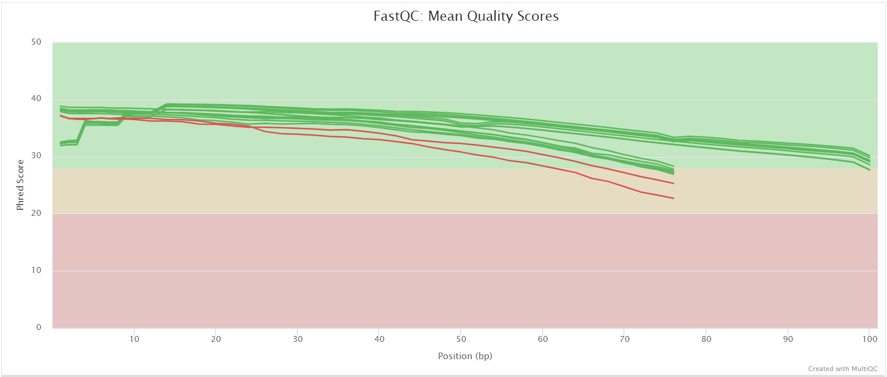

# metagenomicspipeline: Output

## Introduction

This document describes the output produced by the pipeline. The directories listed below will be created in the results directory (`--outdir`) after the pipeline has finished. All paths are relative to the top-level results directory. Folders of steps that were skipped are not created.

Files are copied to the results directory, except the host-filtered and merged reads (`bowtie2/` and `merged/`): these are large, so by default they are symlinks to the Nextflow work directory. Use `--publish_mergedreads copy` to copy them, otherwise they disappear when you clean up the work directory.

The databases the pipeline downloads are not in the results directory but in `db/` in the folder you launched the pipeline from (see [Databases](usage.md#databases) in the usage documentation).

## Pipeline overview

The pipeline is built using [Nextflow](https://www.nextflow.io/) and processes data using the following steps:

- [FastQC](#fastqc) - Raw read QC
- [fastp](#fastp) - Quality filtering and adapter trimming
- [Bowtie2](#bowtie2) - Host read removal
- [Run merging](#run-merging) - Merging the runs of a sample (`--perform_runmerging`)
- [Subsampling](#subsampling) - Subsampling reads to an equal depth
- [MetaPhlAn](#metaphlan) - Taxonomic profiles
- [HUMAnN](#humann) - Gene family and pathway abundances
- [Kraken2](#kraken2) and [Bracken](#bracken) - Taxonomic classification and species abundances (`--skip_kraken false`)
- [ShortBRED](#shortbred) - Antibiotic resistance genes (`--skip_shortbred false`)
- [MultiQC](#multiqc) - Aggregate report describing results and QC from the whole pipeline
- [Pipeline information](#pipeline-information) - Report metrics generated during the workflow execution

Files are named after the sample (`sample` column of the samplesheet). Before run merging, files of samples with several runs are named `<sample>_<run_accession>`.

### FastQC

Output files

- `fastqc/`
  - `*_fastqc.html`: FastQC report containing quality metrics.
  - `*_fastqc.zip`: Zip archive containing the FastQC report, tab-delimited data file and plot images.

[FastQC](http://www.bioinformatics.babraham.ac.uk/projects/fastqc/) gives general quality metrics about your sequenced reads. It provides information about the quality score distribution across your reads, per base sequence content (%A/T/G/C), adapter contamination and overrepresented sequences. For further reading and documentation see the [FastQC help pages](http://www.bioinformatics.babraham.ac.uk/projects/fastqc/Help/).

> [!NOTE]
> FastQC runs on the raw reads, so the FastQC plots in the MultiQC report show _untrimmed_ reads. They may contain adapter sequence and regions with low quality.

### fastp

Output files

- `fastp/`
  - `*.fastp.log`: log of the fastp run, with the number of reads before and after filtering.

[fastp](https://github.com/OpenGene/fastp) filters reads on quality and length and trims adapters. The filtered reads go straight to host read removal and are not saved; the fastp statistics (`*.fastp.json`) are in the MultiQC report.

### Bowtie2

Output files

- `bowtie2/`
  - `*_unmapped_1.fastq.gz`, `*_unmapped_2.fastq.gz`: reads that did not align to the host genome (paired-end), or `*_unmapped.fastq.gz` (single-end). These are the reads used downstream.
  - `*.bowtie2.log`: Bowtie2 alignment summary, with the percentage of host reads.
  - `*.stats`: SAMtools stats of the alignment.

[Bowtie2](https://bowtie-bio.sourceforge.net/bowtie2/index.shtml) aligns the reads to the host reference genome (`--fasta`, `--bowtie2_index` or `--genome`); reads that do not align are kept. When no index is given, the pipeline builds one from `--fasta` and stores it in `db/bowtie2/`. [SAMtools](http://www.htslib.org/) gives the alignment statistics.

### Run merging

Output files

- `merged/`
  - `*_1.merged.fastq.gz`, `*_2.merged.fastq.gz`: reads of all runs of a sample, merged (paired-end), or `*.merged.fastq.gz` (single-end).

Only with `--perform_runmerging`, and only for samples with more than one run in the samplesheet. The runs are merged after host read removal, in the order of their `run_accession`.

### Subsampling

Output files

- `subsampling/`
  - `*_readcount.txt`: number of reads (pairs) of a sample before subsampling.
  - `readcounts_table.csv`: the read counts of all samples in one table.

[SeqKit](https://bioinf.shenwei.me/seqkit/) subsamples the reads of each sample to `--subsamplelevel` reads (pairs), with a fixed seed. Samples with fewer reads are used as they are. The subsampled reads go to the profilers and are not saved.

### MetaPhlAn

Output files

- `metaphlan/`
  - `*_profile.txt`: taxonomic profile per sample (relative abundances with read statistics).
  - `*.mapout.txt`: marker gene alignments per sample, which MetaPhlAn can reuse as input.
  - `*.sam.bz2`: compressed alignments to the marker genes.
  - `combined_table.txt`: the profiles of all samples merged in one table.

[MetaPhlAn](https://github.com/biobakery/MetaPhlAn) profiles the taxonomic composition of each sample with clade-specific marker genes.

### HUMAnN

Output files

- `humann/`
  - `humann_results/`: output of HUMAnN per sample
    - `*_genefamilies.tsv`: gene family abundances in reads per kilobase (RPK)
    - `*_pathabundance.tsv`: pathway abundances
    - `*_reactions.tsv`: reaction abundances
  - `logs/`: HUMAnN log per sample
  - `pathway_abundance.txt`: pathway abundances of all samples (merged)
  - `pathway_abundance_cpm.txt`: the same, in copies per million
  - `pathway_abundance_cpm_stratified.txt`: in copies per million, per pathway and contributing taxon
  - `pathway_abundance_cpm_unstratified.txt`: in copies per million, per pathway

[HUMAnN](https://github.com/biobakery/humann) quantifies gene families and metabolic pathways, to describe the functional potential of the microbial community. The forward and reverse reads of a sample are combined before HUMAnN runs.

### Kraken2

Output files

- `kraken2/`
  - `*.kraken2.report.txt`: Kraken2 report per sample: the number and percentage of reads assigned to each taxon.
  - `*.classified_1.fastq`, `*.unclassified_1.fastq` (and `_2`): classified and unclassified reads, only with `--kraken2_save_reads`.
  - `*.kraken2.classifiedreads.txt`: the classification of every read, only with `--kraken2_save_readclassifications`.

[Kraken2](https://github.com/DerrickWood/kraken2) assigns each read to a taxon by matching its k-mers to a database: `--kraken2_db`, or a prebuilt database downloaded with `--kraken2_dbname`.

### Bracken

Output files

- `bracken/`
  - `*.tsv`: species abundances per sample, re-estimated from the Kraken2 report.
  - `*.kraken2.report_bracken.txt`: the Kraken2 report with Bracken's species abundances, for all taxonomic levels.
  - `combined_brackenoutput.txt`: species read counts (`_num`) and fractions (`_frac`) of all samples in one table.
  - `combined_krakenoutput.txt`: the Kraken2-style reports of all samples in one table, with the abundance of each taxon at all levels.

[Bracken](https://github.com/jenniferlu717/Bracken) redistributes the reads that Kraken2 assigned to higher taxonomic levels to the species below them, for more accurate species abundances. It needs Bracken files for the read length (`--bracken_readlength`) in the database; build them with `--bracken_build` if the database has none.

### ShortBRED

Output files

- `shortbred/`
  - `*_shortbred`: abundance of each antibiotic resistance gene family per sample.

[ShortBRED](https://github.com/biobakery/shortbred) quantifies antibiotic resistance genes with the CARD (2017) marker set, which is downloaded to `db/`.

### MultiQC

Output files

- `multiqc/`
  - `multiqc_report.html`: a standalone HTML file that can be viewed in your web browser.
  - `multiqc_data/`: directory containing parsed statistics from the different tools used in the pipeline.
  - `multiqc_plots/`: directory containing static images from the report in various formats.

[MultiQC](http://multiqc.info) generates a single HTML report summarising all samples. It includes FastQC, fastp, Bowtie2, MetaPhlAn and Kraken2 results, the software versions, the parameters of the run and a suggested methods description.

### Pipeline information

Output files

- `pipeline_info/`
  - Reports generated by Nextflow: `execution_report_<date>.html`, `execution_timeline_<date>.html`, `execution_trace_<date>.txt` and `pipeline_dag_<date>.html`.
  - Reports generated by the pipeline: `pipeline_report.html` and `pipeline_report.txt`, only present if the `--email` / `--email_on_fail` parameters are used when running the pipeline.
  - Software versions: `software_versions.tsv` (one row per process and tool) and `metagenomicspipeline_software_mqc_versions.yml` (the same, as shown in the MultiQC report).
  - `git_commit_hash.txt`: the commit of the pipeline code that was run.
  - Parameters used by the pipeline run: `params_<date>.json`.

[Nextflow](https://www.nextflow.io/docs/latest/reports.html) generates reports about the run: resource usage and run time per task, and the order in which tasks ran. Use them to troubleshoot errors and to tune the resources of the pipeline.
